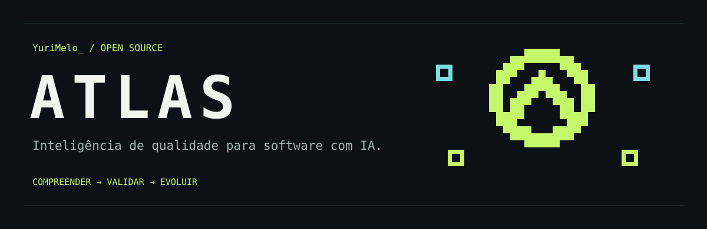
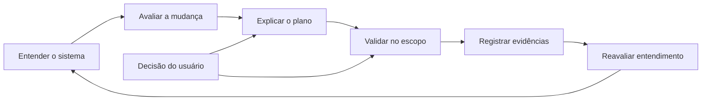
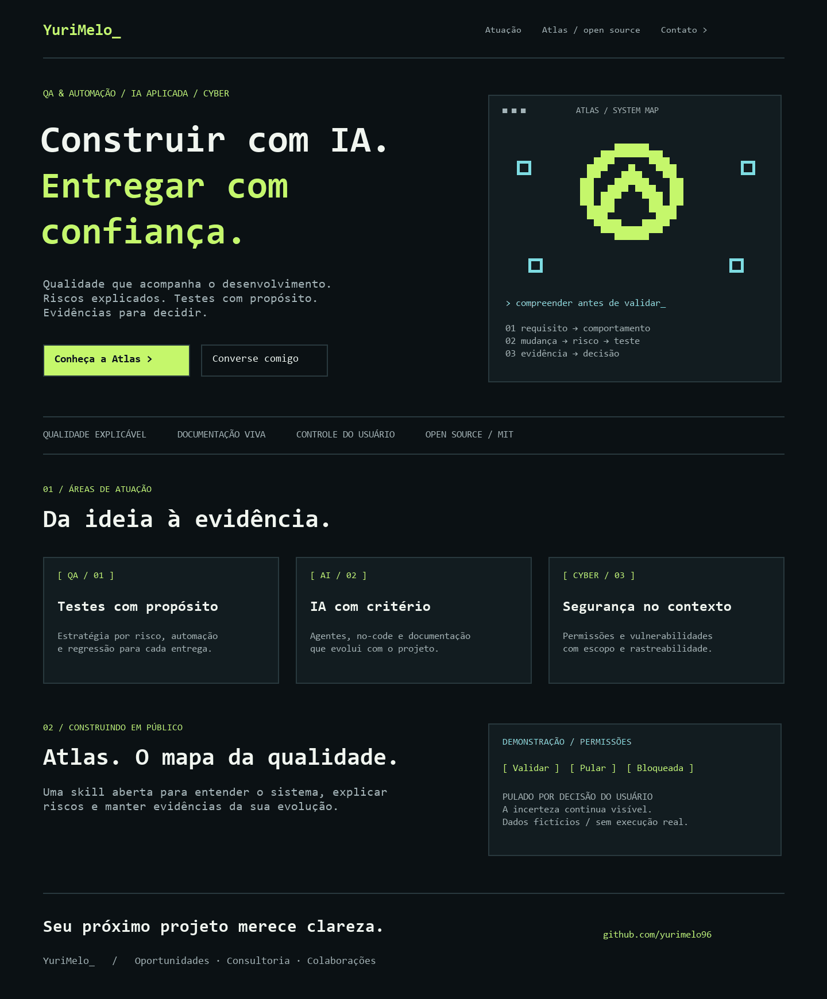

<p align="center"></p>

<p align="center"><strong>Inteligência de qualidade para quem constrói software com IA.</strong><br>Entenda o sistema. Explique os riscos. Valide com evidências.</p>

<p align="center"><a href="#comece-aqui">Comece aqui</a> · <a href="#como-funciona">Como funciona</a> · <a href="#você-no-controle">Você no controle</a> · <a href="#contribua">Contribua</a> · <a href="https://github.com/yurimelo96">YuriMelo</a></p>

<p align="center">  </p>

**Atlas é uma skill aberta criada por YuriMelo para acompanhar a qualidade durante o desenvolvimento.** Ela orienta um agente a compreender o projeto, avaliar mudanças, escolher verificações e manter documentação com rastreabilidade. Funciona como instruções para o agente, com um pequeno helper opcional em Python.

> **English:** Atlas is an open quality intelligence skill for AI coding agents. It connects requirements, changes, risk and evidence while keeping users in control. The skill instructions are in English; agents should respond in the user's language.

## Por que existe

Uma entrega precisa de mais do que um “pronto”. Qual requisito foi atendido? Que comportamento mudou? O teste realmente verificou isso? O que não foi possível verificar?

Atlas ajuda a tornar essas respostas parte do trabalho. Seu princípio é simples: **qualidade precisa ser compreensível para quem toma a decisão.**

## Comece aqui

1. Baixe ou clone este repositório.
2. Copie **a pasta inteira** `skills/atlas-quality` para o diretório de skills aceito pelo seu agente. Preserve `references/` e `scripts/`.
3. Abra seu projeto no agente e invoque a skill. O local de instalação e a descoberta automática dependem do ambiente.

```text
Use $atlas-quality para mapear este projeto e propor uma estratégia de
qualidade. Explique os riscos e os testes recomendados. Crie documentação
viva aproveitando os documentos existentes.
```

Para validar uma mudança:

```text
Use $atlas-quality para avaliar o diff desta branch contra main.
Relacione requisitos, riscos e verificações. Execute os testes relevantes
e informe o que ficou pendente.
```

Você precisa de um agente capaz de ler arquivos e das ferramentas exigidas pelo projeto para executar testes. **Python 3.10+ é necessário apenas para o helper opcional.** A skill não instala scanners ou frameworks.

## Como funciona



| Momento | Atlas investiga | Você recebe |
|---|---|---|
| Início do projeto | Arquitetura, jornadas, dados, regras, ferramentas e desconhecidos | Mapa inicial com fontes e limites |
| Alteração ou commit solicitado | Diff, consumidores e fronteiras afetadas | Riscos e verificações proporcionais |
| Implementação | Comportamentos, contratos, falhas e regressões | Testes úteis nas camadas pertinentes |
| Verificação | Resultados reais, falhas, skips e bloqueios | Conclusão sustentada por evidências |
| Evolução | Decisões e pressupostos que mudaram | Documentação atualizada e pendências visíveis |

**Ela atua quando o agente a utiliza.** Não há monitor em segundo plano nem hook automático por commit. Para incluir esse fluxo em todo desenvolvimento, adicione uma instrução ao projeto e/ou uma integração de CI adequada. O workflow deste repositório testa o helper da Atlas; ele não valida automaticamente aplicações de terceiros.

## Você no controle

Você pode dizer “pule”, “adie”, “reduza o escopo” ou “use outro método”. Atlas explica a consequência e continua com as verificações independentes.

> **Exemplo ilustrativo:** “A mudança afeta permissões. Recomendo verificar acesso entre perfis porque uma falha pode expor dados de outra conta.”
>
> **Você:** “Adie essa validação para amanhã.”
>
> **Atlas:** “Registrado como adiado por sua decisão. Esse acesso permanece sem validação; seguirei com os demais testes.”

Uma etapa pulada fica **pulada**. Uma ferramenta indisponível fica **bloqueada**. Nenhuma dessas situações se transforma em aprovação.

## Arquitetura de qualidade para o seu sistema

A partir do código disponível ou da sua descrição, Atlas cruza **produto + stack + riscos + acessos + capacidade de manutenção** para recomendar camadas de teste, frameworks, ferramentas e skills. Primeiro aproveita o que existe; pergunta apenas o que muda a decisão. Se tiver somente uma descrição, a recomendação fica marcada como provisória.

```text
Use $atlas-quality. Meu sistema é um SaaS em FastAPI e PostgreSQL,
feito com ajuda de IA. Analise o que está disponível e recomende uma
arquitetura de qualidade. Explique prioridades, ferramentas e skills,
o que posso executar agora e o que depende de configuração.
```

Por exemplo, após confirmar as características do produto:

| Contexto | Possível recomendação | Motivo |
|---|---|---|
| Regras Python e API FastAPI | pytest e cliente de teste compatível com o modelo síncrono/assíncrono | Verificar regras, contratos e falhas |
| PostgreSQL | Banco isolado com fixtures e testes de migração | Verificar integridade e comportamento real do banco |
| SaaS multi-tenant, se confirmado | Matriz de autorização entre organizações | Detectar acesso indevido a dados de outra conta |
| Interface web, se existir | Suíte existente ou Playwright para jornadas críticas | Verificar integração entre camadas pela experiência do usuário |
| Cobrança, se existir | Sandbox do provedor e testes de webhooks | Detectar duplicidade e eventos inválidos |
| Modelo de IA dentro do produto, se existir | Conjunto de evals versionado | Avaliar comportamento não determinístico e ações do modelo |

“Feito com IA” não significa que o produto tem uma funcionalidade de IA ou que seu código está defeituoso. A recomendação parte do comportamento esperado e das evidências.

### MCP, CLI, browser, frameworks e IAs

Atlas orienta o agente a descobrir e verificar **as capacidades realmente disponíveis no ambiente**, incluindo conectores/MCP, terminal, controle de navegador, frameworks, scanners, serviços de IA e CI. Para cada acesso necessário, registra estado, alvo, limites e alternativa.

- **MCP/conector:** acesso a serviços e informações.
- **CLI/CI:** execução reproduzível dos comandos do projeto.
- **Browser:** exploração e observação de jornadas.
- **Framework:** testes mantidos e repetíveis.
- **Skill:** orientação especializada para conduzir o trabalho.
- **IA/evals:** apoio à análise ou avaliação de funções de IA, conforme o caso.

Essas peças podem trabalhar juntas. Atlas propõe a combinação adequada e separa **disponível**, **não configurado**, **autenticação necessária**, **bloqueado** e **desconhecido**. Não instala todos os frameworks, habilita credenciais ou promete compatibilidade universal. Skills externas são verificadas antes de serem sugeridas como candidatas; nomes de invocação dependem do catálogo real.

Veja o [guia de acesso a ferramentas](skills/atlas-quality/references/tool-access.md) e o [exemplo completo de arquitetura FastAPI/PostgreSQL](skills/atlas-quality/references/quality-architecture.md).

## Qualidade em várias camadas

| Área | Atuação orientada pela skill |
|---|---|
| QA e automação | Estratégia por risco, testes unitários, integração, contrato, E2E e regressão |
| IA | Revisão de código gerado, evals de funcionalidades de IA e limites de confiança |
| No-code / low-code | Workflows, permissões, integrações, limites da plataforma e versões exportadas |
| Cyber | Seleção e interpretação de scanners existentes; testes ativos dentro do escopo autorizado |
| Acessibilidade e design | Verificações automatizadas e manuais, teclado, foco, estados, responsividade |
| Privacidade e legislação | Pesquisa de fontes oficiais atuais, contexto de aplicação e lacunas técnicas |
| Documentação | Mapa do sistema, regras, decisões e relação entre mudanças e evidências |

Consulte [validação](skills/atlas-quality/references/validation.md), [segurança e privacidade](skills/atlas-quality/references/security-privacy.md) e [registros](skills/atlas-quality/references/records.md).

**Escopo honesto:** Atlas não inclui um scanner próprio, não garante ausência de bugs, não certifica acessibilidade ou conformidade legal e não substitui avaliação jurídica. Scanners externos precisam estar disponíveis e configurados. A profundidade depende das ferramentas, do acesso e das evidências do projeto.

## Documentação viva e logs

```text
requisito → mudança → risco → verificação → evidência → decisão
```

Prioriza documentação já existente. Quando necessário, inicia `docs/quality/` com mapa, decisões e mudanças. Registros de execução ficam em `.atlas/runs/`, com ID único, horário UTC, revisão Git observada, estado de alterações locais e resultado do processo.

O helper não salva saída nem argumentos completos do comando por padrão. Rótulos e justificativas continuam exigindo cuidado. Revise artefatos antes de compartilhar; arquivos locais são editáveis e não constituem trilha inviolável de auditoria.

### Helper opcional

Execute a partir da raiz deste repositório, substituindo `/caminho/do/projeto` por um diretório existente:

```sh
python skills/atlas-quality/scripts/atlas.py init --project /caminho/do/projeto
python skills/atlas-quality/scripts/atlas.py run --project /caminho/do/projeto --label unit -- python -m unittest
python skills/atlas-quality/scripts/atlas.py run --project /caminho/do/projeto --label e2e --skip --reason "Adiado pelo usuário"
```

| Saída | Significado |
|---|---|
| `0` | Comando terminou com zero; evidência ainda precisa de interpretação |
| `1` | Comando terminou com falha |
| `2` | Pulo, bloqueio, timeout ou uso inválido; não aprovado |

Um comando sem testes também pode terminar com zero. Por isso o helper registra `executed`, nunca `passed`. Para guardar relatórios, configure a ferramenta de teste para gravá-los em um local revisável. O timeout encerra o processo direto; ferramentas que criam subprocessos precisam de gerenciamento adicional. O helper não é um sandbox.

## Marca e mockup

A direção visual une **YuriMelo + Atlas**, tipografia de terminal, mapa em pixel e verde elétrico sobre fundo escuro. O conceito de apresentação profissional está em [mockup/index.html](mockup/index.html); abra o arquivo no navegador após baixar o projeto. É uma proposta de portfólio, sem formulário ou backend e sem números, clientes ou certificações inventados.



## Contribua

O projeto está em **0.2.0** e evolui com uso real. Bugs reproduzíveis, melhorias de acessibilidade, exemplos pequenos e traduções são bem-vindos. Consulte [CONTRIBUTING.md](CONTRIBUTING.md) e [SECURITY.md](SECURITY.md).

Para verificar o helper:

```sh
python -m unittest discover -s tests -v
```

Os testes cobrem preservação de documentos, resultados de processos, falhas, skips, timeout e ausência de captura de saída. Eles não demonstram a eficácia de todos os comportamentos do agente. Veja [cenários de avaliação](docs/evaluation.md).

Próximos passos propostos: validar o comportamento em projetos reais, documentar estudos de caso reproduzíveis e adicionar integrações conforme a demanda. Esses itens ainda não são funcionalidades entregues.

## Criado por YuriMelo

Uma iniciativa aberta para compartilhar conhecimento e construir qualidade em público, conectando **QA & automação · IA aplicada · Cyber**.

Quer conversar sobre oportunidades, consultoria ou projetos? [Encontre YuriMelo no GitHub](https://github.com/yurimelo96).

### Referências e créditos

As discussões iniciais foram inspiradas por [petrkindlmann/qa-skills](https://github.com/petrkindlmann/qa-skills) e [PramodDutta/qaskills](https://github.com/PramodDutta/qaskills). A implementação e os recursos visuais deste projeto foram escritos para Atlas; as ferramentas citadas pertencem aos respectivos projetos. Sem afiliação ou endosso implícito.

Código e documentação: [MIT](LICENSE). Copyright © 2026 YuriMelo.
